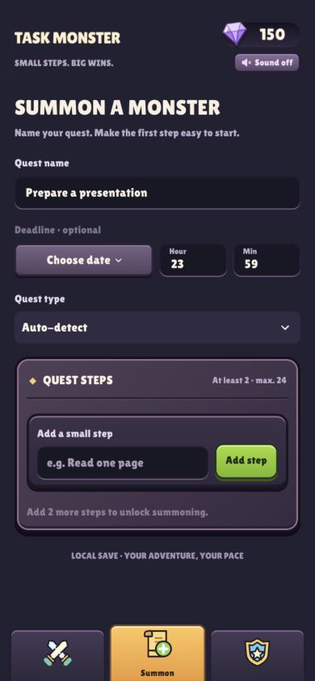
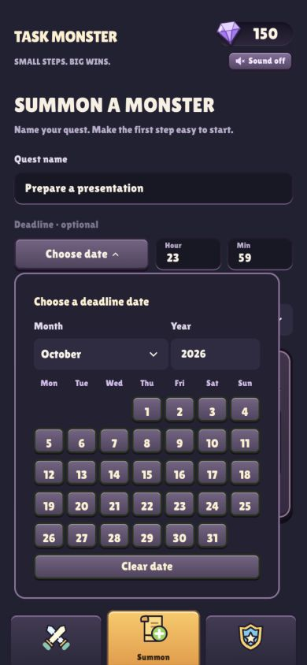
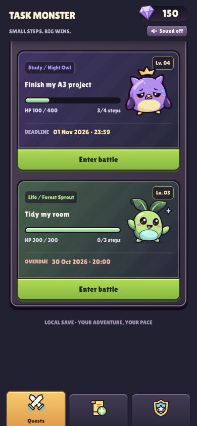
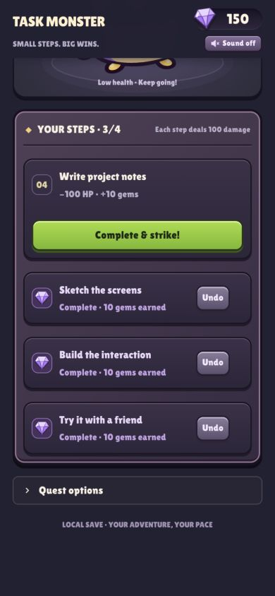
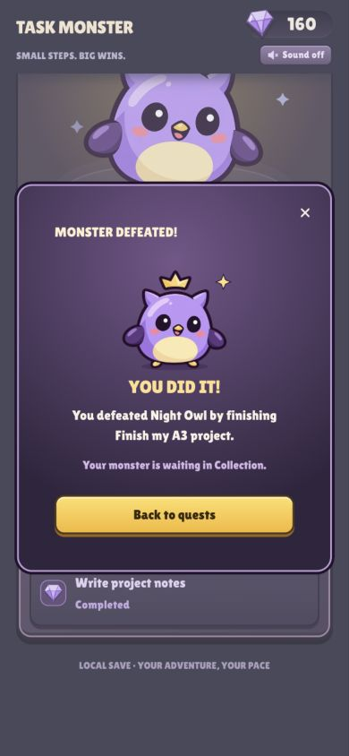
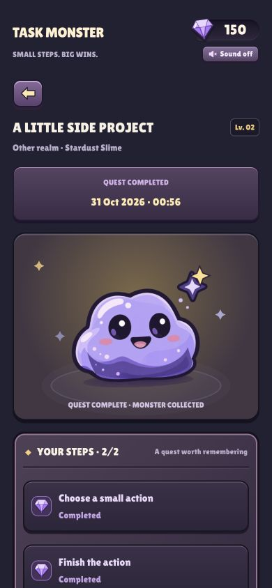

# Task Monster

**Small steps. Big wins.** Task Monster is a small interactive task tool for students who find large assignments difficult to start. Turn a real task into a quest, break it into manageable steps, and defeat a monster by finishing those steps.

**[Read the development process and classmate trial → PROCESS.md](PROCESS.md)**

## The experience

The intended user is a student with a task they know they need to do but keep putting off. The aim is to make the next small action clear and make progress visible. The app does not verify real-world work: the player decides when a step is finished.

| Deliberate input | Program response | Feedback and next action |
| --- | --- | --- |
| Type a quest name, optionally set a deadline, and add 2–24 steps | Create a quest with a monster; each step contributes 100 HP | The quest appears on the board; choose **Enter battle** |
| Finish a step in real life, then press **Complete & strike!** | Mark that step complete, recalculate health and award 10 gems | Health decreases, the expression changes, gems animate toward the wallet, and an optional sound plays |
| Press **Undo** on an active quest | Restore the step, health and corresponding gem balance | The step returns to the pending group; the monster returns to its matching state |
| Complete the final step | Save completion time and collect the monster | A victory dialog and optional fanfare appear; dismissing the dialog returns to the board |

This is a working input → response → feedback loop, not a static illustration. The next action remains visible in the pending-step list. Back returns to the previous screen, and completed quests open as read-only recaps.

## Screenshots

All nine captures use the same **390 × 844** viewport and display at the same size. Click a picture to inspect it. The tasks and progress shown here are fictional demonstration data, separate from the classmate trial described in PROCESS.md.

<table>
<tr>
<td align="center" valign="top"><a href="task-monster/assets/screenshots/home.jpg"></a><br><b>1. Quest board</b></td>
<td align="center" valign="top"><a href="task-monster/assets/screenshots/battle.jpg"></a><br><b>2. Battle and health</b></td>
<td align="center" valign="top"><a href="task-monster/assets/screenshots/gallery.jpg"></a><br><b>3. Monster collection</b></td>
</tr>
<tr>
<td align="center" valign="top"><a href="task-monster/assets/screenshots/create.jpg"></a><br><b>4. Create a quest</b></td>
<td align="center" valign="top"><a href="task-monster/assets/screenshots/calendar.jpg"></a><br><b>5. Choose a deadline</b></td>
<td align="center" valign="top"><a href="task-monster/assets/screenshots/deadlines.jpg"></a><br><b>6. Deadline feedback</b></td>
</tr>
<tr>
<td align="center" valign="top"><a href="task-monster/assets/screenshots/steps.jpg"></a><br><b>7. Steps and Undo</b></td>
<td align="center" valign="top"><a href="task-monster/assets/screenshots/victory.jpg"></a><br><b>8. Quest complete</b></td>
<td align="center" valign="top"><a href="task-monster/assets/screenshots/review.jpg"></a><br><b>9. Completed quest recap</b></td>
</tr>
</table>

## Run locally

Install [uv](https://docs.astral.sh/uv/getting-started/installation/), clone or download this repository, and open a fresh terminal at its root:

```bash
cd task-monster
uv sync --locked
uv run --locked streamlit run app.py
```

Open the URL printed in the terminal, normally **http://localhost:8501**. Keep the terminal open. Press **Ctrl+C** to stop. After updating a running copy, stop it, run the commands again, and refresh the browser.

The app selects Python 3.13 through [.python-version](task-monster/.python-version). [pyproject.toml](task-monster/pyproject.toml) declares Streamlit and [uv.lock](task-monster/uv.lock) pins the dependency versions. Installing dependencies initially needs internet access. The running interaction uses bundled images/fonts and local sound synthesis; it needs no API key, paid account, model download, GPU or microphone. This is a local web app; no hosted live demo is provided.

## How to use it

1. Select **Summon**, name the quest, and optionally choose a date and type the hour/minute. Deadlines use Hong Kong time. Select a quest type or keep **Auto-detect**.
2. Add at least two small actions. The gold **Summon monster** action unlocks above the step list. Red trash buttons remove draft steps.
3. Enter a battle from **Quests**. Do the real-world action before marking it complete. Pending steps stay first; completed steps move below them in completion order.
4. Use **Undo** for an accidental completion while the quest is active. To stop pursuing a quest, open **Quest options** and explicitly confirm **Abandon quest**.
5. Finish every step to collect the monster. In **Collection**, choose **View quest** to revisit its steps and saved completion time.

Use **Sound off** beside the gem wallet to enable music and effects together. Sound starts muted, pauses background music while the tab is hidden, and can be muted at any time. Reloading resets it to off. Health, text and animation communicate the outcome even without audio.

## Classmate trial and iteration

Two classmates tried the app. One knew the assignment brief but received no explanation of this app; the other received a short introduction to its purpose. Both operated it smoothly. Their feedback informed the addition of optional deadlines and refinement of the monster artwork. [PROCESS.md](PROCESS.md#classmate-trial-and-response) records the trial context, feedback and design decisions without identifying participants.

## Mistakes, interruption and limitations

- Empty names or steps, fewer than two steps, and invalid deadline times produce an English message instead of creating an invalid quest.
- Health and gems are derived from completed steps. Undo/re-completion cannot accumulate extra rewards, and collected quests cannot be attacked again.
- Progress saves automatically to `task-monster/local_data/tasks.json`, which Git ignores. A missing save starts a new adventure. A malformed save is preserved with a warning instead of being overwritten. Stop the app and back up or repair that file before restarting. Writes use atomic replacement to avoid half-written JSON.
- This is a single-user local prototype with one shared save per server. It has no accounts, cloud sync or concurrent-edit protection. Browsers connected to the same server share the save.
- There are six species. Category detection uses local English keyword rules and can be overridden; it is not an AI service. All steps deal equal damage, and steps cannot be edited after summoning.
- Deadlines are visual reminders, not notifications. The interface is a responsive web page with a phone-style frame, not a native mobile app.

## Verification and project files

From `task-monster`:

```bash
uv run --locked python -m unittest discover -s tests -v
```

The current suite has **20 local checks** for creation, health/undo, rewards, victory, navigation, persistence, legacy saves, English calendar and keyboard deadlines. With Node.js installed, `node --test tests/audio.test.cjs` runs two optional audio checks. There is no GitHub automatic-check workflow.

- [PROCESS.md](PROCESS.md): starting idea, iteration, classmate trial, AI tools and decisions.
- [app.py](task-monster/app.py): screens and interaction callbacks.
- [game.py](task-monster/game.py): task state, health, validation and JSON storage.
- [deadline_picker.py](task-monster/deadline_picker.py): English calendar and keyboard time entry.
- [art.py](task-monster/art.py) and [assets](task-monster/assets): local artwork, icons, font, sound and feedback.
- [Development history](https://github.com/Whitter-oy/Task-monster-A3/commits/main/): actual commits made during the project.

## Credits

Python lists, dictionaries, functions, state and Streamlit build on SD5913 classroom concepts. The project extends those ideas with multiple quests, persistent progress, a battle/collection loop, deadlines and audiovisual feedback; it is not an unchanged tutorial example.

The project author supplied the six monster images and group portrait. Original source filenames and hashes are recorded in [SOURCES.json](task-monster/assets/monsters/SOURCES.json); the generation tool for those supplied originals was not recorded. OpenAI built-in image generation produced the hurt/weak variants from them, with [prompts retained](task-monster/assets/monsters/EXPRESSION-PROMPTS.json). Codex assisted with design, Python, CSS, original SVG icons, testing and documentation. It also composed the melody/effects and implemented Web Audio oscillator synthesis; no existing recordings or sampled music are bundled. [PROCESS.md](PROCESS.md#ai-tools-and-decisions) explains suggestions kept and changed.

Lilita One by Juan Montoreano is bundled under the [SIL Open Font License](task-monster/assets/fonts/OFL.txt). Reference game screenshots informed the visual direction; their assets were not copied. Personal task files and recordings of classmates are not included in the repository.
