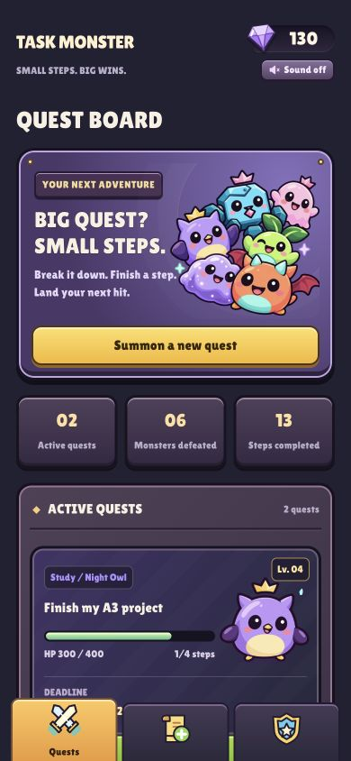
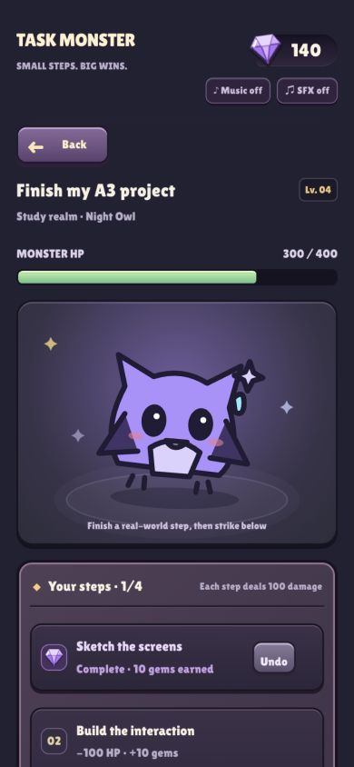
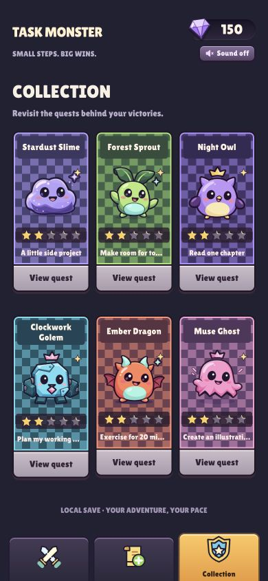
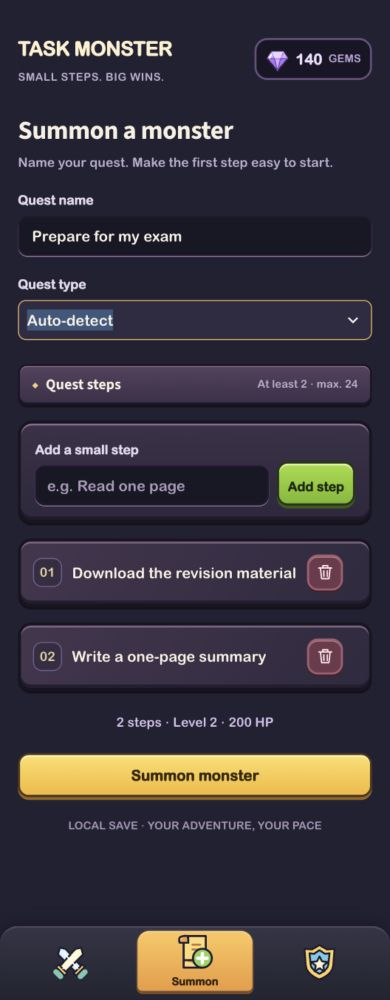
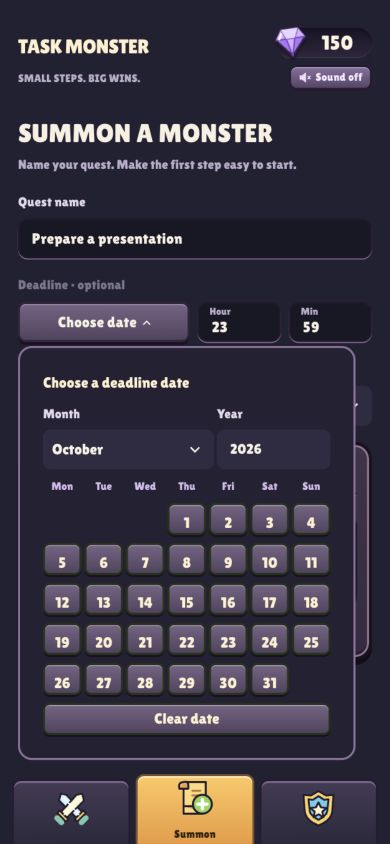
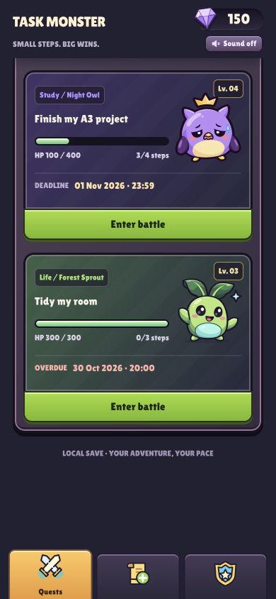
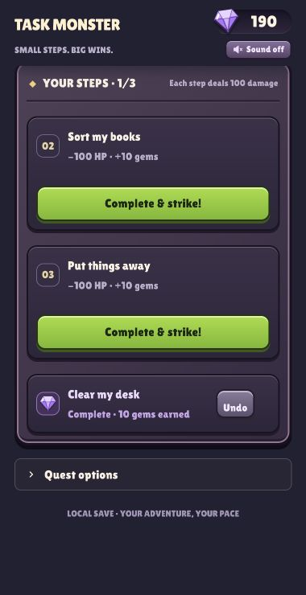
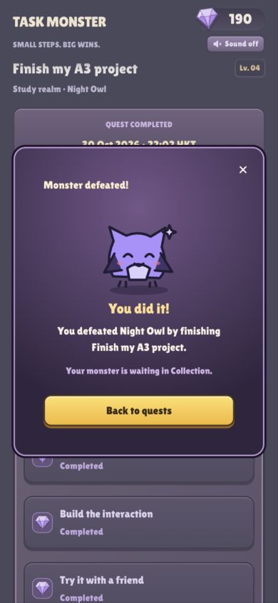
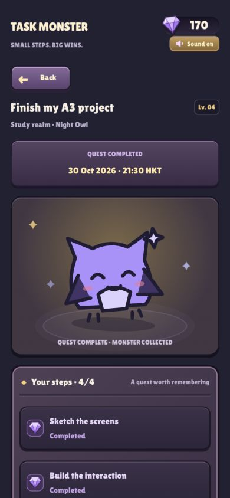

# Task Monster

**Small steps. Big wins.** Task Monster turns a large task into a small adventure. Create a quest, break it into manageable steps, and defeat a friendly monster by completing those steps in real life. Each finished quest becomes a collectible card: a small record of something you have accomplished.

I designed it for students who know what they need to do but find a large assignment difficult to start. The goal is to make the next action feel approachable and give each small effort an immediate, visible response. Instead of looking only at how much work remains, the player can see the progress they have already made.

## Project at a glance

| | |
| --- | --- |
| **Format** | Functional, single-user web application developed as coursework |
| **Technology** | Python, Streamlit, CSS, JavaScript, Web Audio and local JSON storage |
| **Design focus** | Task breakdown, visible progress, expressive feedback and mobile-sized interaction flows |
| **Evaluation** | Qualitative trials with two classmates, followed by deadline and character-feedback improvements |
| **AI-assisted development** | Codex supported implementation and iteration. The running app does not call an AI service. |

[Build and design process](PROCESS.md) · [How I used AI](PROCESS.md#7-how-i-used-ai) · [Install and run](#install-and-open)

## Screenshots

The nine screens below show the full journey, from creating a quest to looking back at a completed one. Each screenshot uses the same 390 × 844 viewport. Click an image to view it at full size. The tasks shown are fictional demonstration examples.

<table>
<tr>
<td align="center" valign="top"><a href="task-monster/assets/screenshots/home.jpg"></a><br><b>1. Quest board</b></td>
<td align="center" valign="top"><a href="task-monster/assets/screenshots/battle.jpg"></a><br><b>2. Battle and health</b></td>
<td align="center" valign="top"><a href="task-monster/assets/screenshots/gallery.jpg"></a><br><b>3. Monster collection</b></td>
</tr>
<tr>
<td align="center" valign="top"><a href="task-monster/assets/screenshots/create.jpg"></a><br><b>4. Create a quest</b></td>
<td align="center" valign="top"><a href="task-monster/assets/screenshots/calendar.jpg"></a><br><b>5. Choose a deadline</b></td>
<td align="center" valign="top"><a href="task-monster/assets/screenshots/deadlines.jpg"></a><br><b>6. Deadline feedback</b></td>
</tr>
<tr>
<td align="center" valign="top"><a href="task-monster/assets/screenshots/steps.jpg"></a><br><b>7. Steps and Undo</b></td>
<td align="center" valign="top"><a href="task-monster/assets/screenshots/victory.jpg"></a><br><b>8. Quest complete</b></td>
<td align="center" valign="top"><a href="task-monster/assets/screenshots/review.jpg"></a><br><b>9. Completed quest recap</b></td>
</tr>
</table>

## Product links

[Task Monster on GitHub](https://github.com/Whitter-oy/Task-monster-A3)

After installing and starting the app, open [Task Monster locally](http://localhost:8501) in your browser. This address connects to the app running on your own computer.

## Install and open

Install [uv](https://docs.astral.sh/uv/getting-started/installation/), then run these commands in a terminal:

```bash
git clone https://github.com/Whitter-oy/Task-monster-A3.git
cd Task-monster-A3/task-monster
uv sync --locked
uv run --locked streamlit run app.py
```

Cloning uses Git. If Git is not installed, choose **Code → Download ZIP** on this repository, extract it, open a terminal in the extracted `task-monster` folder, and run the last two commands instead. If you already have the repository, use its `task-monster` folder. Open the URL printed by Streamlit, normally **http://localhost:8501**. Keep the terminal open while using the app, and press **Ctrl+C** to stop it. After updating a running copy, stop it, start it again and refresh the browser.

The project selects Python 3.13 and includes its dependency metadata and lockfile. Initial setup needs an internet connection to install dependencies. Images, fonts and sound are bundled or produced locally, so using the app does not require an API key, paid account, model download or microphone.

This is a single-user local prototype: each running server uses one save file, with no accounts or cloud sync. Task completion is self-reported, and deadlines are displayed reminders rather than notifications.

## Your quest, step by step

1. **Name the quest.** Select **Summon** and enter a real task, such as preparing a presentation. Choose a task type, or let **Auto-detect** select one. You can optionally choose a deadline date and type the hour and minute.
2. **Make it smaller.** Add 2–24 concrete steps. The separate green **Add step** button builds the list; red trash buttons remove draft steps. Once there are at least two steps, the gold **Summon monster** button appears above the list.
3. **Enter the battle.** Your quest appears on the board with its monster, health, progress and deadline. Choose **Enter battle**, then do one of the real-world actions before pressing **Complete & strike!**.
4. **See the response.** Each completion removes 100 HP and adds 10 gems. The monster changes expression, gems fly toward the wallet and an optional sound marks the hit. Completed steps move below the pending ones so the next action stays easy to find.
5. **Collect the victory.** Completing every step opens a celebration dialog. Close it to return to the quest board. The monster now appears in **Collection**, where **View quest** opens a recap of the steps and completion time.

The Back arrow returns to the previous screen. The three main navigation tiles switch between Quests, Summon and Collection. Use the sound switch beside the wallet to enable or mute music and effects together.

## Why I designed it this way

### A task becomes a monster

A large task can feel abstract. Giving it a visible character and a health bar makes the remaining work easier to understand: every small action makes a clear difference. Health comes directly from the step list, with 100 HP per step, so the relationship between effort and progress stays simple.

I chose friendly, rounded characters to keep the battle playful. Six species give different task types their own identity: Night Owl for Study, Clockwork Golem for Work, Ember Dragon for Fitness, Forest Sprout for Life, Muse Ghost for Creative and Stardust Slime for Other. Collection card colors follow each monster's palette, helping the character and its card feel like one design.

The monsters also react to progress. They begin cheerful, look hurt after a hit, and become visibly tired when their remaining health falls to 35% or less. Undo restores the expression that matches the restored health. Once collected, they return to their cheerful appearance. This gives the health change a more expressive counterpart than a number alone.

### A small game world in the interface

The deep purple background, warm cream lettering and gold highlights create a consistent game-like setting. Rounded cards, inset highlights and raised buttons make the controls feel tangible. I used Lilita One by Juan Montoreano for its friendly cartoon lettering; its [font license](task-monster/assets/fonts/OFL.txt) is included with the project.

Color helps explain what to do. Green means add or complete an action, gold marks summoning and major continuation, purple supports Undo and Back, and red identifies removal. The phone-style layout keeps the experience compact, while the selected navigation tile gains a label to show where the player is. Battle screens use a Back arrow and focus on the quest itself.

### Rewards that keep attention on the next step

The gem animation connects a completed action to the wallet, making a small reward visible. The balance is calculated from completed steps, so undoing and repeating a step cannot build extra gems. Completed steps move to the bottom of the list, keeping unfinished work near the top.

Collection is a record of finished tasks. A victory dialog gives the final step a distinct moment, then returns the player to the board. The recap preserves the task's steps and completion time without presenting more battle controls.

### Music and sound with a purpose

The background melody supports the playful atmosphere, while navigation, summoning, attacks, gems, Undo and victory have different cues. An attack sound marks a step; the longer victory fanfare marks completion of the whole quest. This helps distinguish ordinary progress from finishing.

The music and effects were composed with Codex assistance and synthesized using Web Audio oscillators. The app starts muted and uses one switch for all sound. Background music pauses when the tab is hidden, and visual feedback still explains what happened when sound is off. I wanted the audio to be an optional part of the experience that the player controls.

### Deadlines without complicating creation

Classmate feedback led me to add optional deadlines. A date and time can be set directly under Quest Name, and active cards show the deadline or an overdue label. Keeping it optional makes the same flow suitable for both a scheduled assignment and a personal task without a fixed due date. Dates use Hong Kong time; the calendar stays in English, and hours and minutes can be typed directly.

## Mistakes

An empty quest name or step produces a clear message. Summoning stays locked until two steps exist, and invalid hours or minutes cannot be saved as a deadline. These checks let the player correct the entry in place.

If a step is completed accidentally, **Undo** restores the step, its health and the corresponding gem balance while the quest is active. Removing an entire quest is separate: **Quest options → Abandon quest** requires an explicit confirmation.

Progress saves automatically. If a saved file cannot be read, the app warns the player and preserves it rather than replacing it with an empty list. The file can then be backed up or repaired before restarting. Personal progress stays in the Git-ignored `task-monster/local_data` folder.

## User testing and improvements

Two classmates tried Task Monster. The first studies in the same programme and knew the assignment requirements, but did not know this app's theme. I let them use it without explaining the app. The second received a short introduction to its purpose before trying it. Both operated it smoothly, and I did not observe a particular point where either became stuck.

Their feedback suggested adding task deadlines and improving the monster imagery. In response, I added the optional date/time fields and deadline labels on the quest board, refined the character illustrations and group portrait, and introduced different expressions for different health states. I kept the main quest → step → battle → collection flow because both classmates could use it comfortably.
