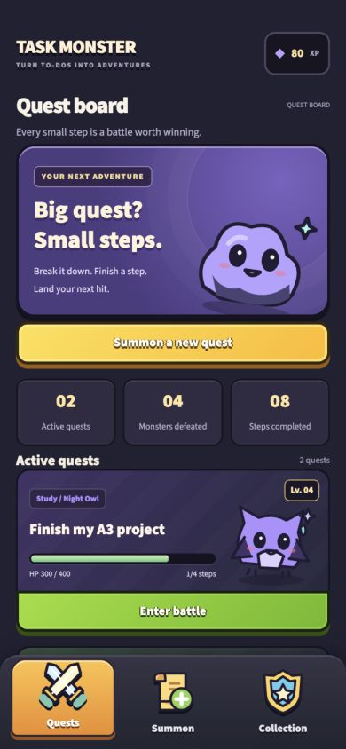
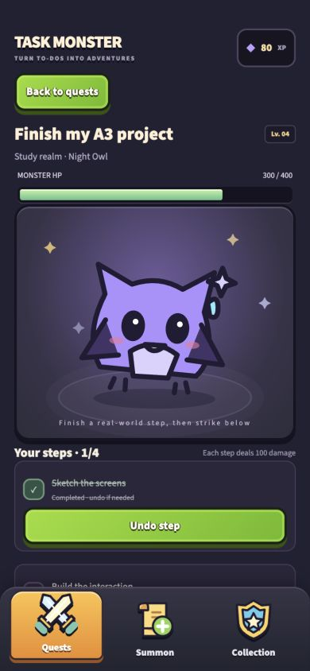
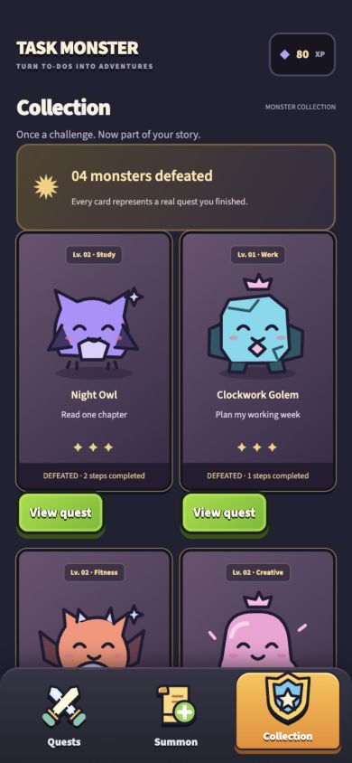

# Task Monster · Quest Adventure

A game-inspired task tool for students who need help starting large tasks. A task becomes a monster, its steps become attacks, and a completed task becomes a collectible card.

## Run

Open a terminal in this directory:

```bash
uv sync --locked
uv run streamlit run app.py
```

Open the URL printed by Streamlit, normally http://localhost:8501. Press Ctrl+C to stop. To update a running app, stop it, run the commands again, and refresh the browser. Python 3.13 is selected in `.python-version`; `uv.lock` records dependencies.

## Play

- **Quests:** browse active monsters, level, health and progress, then select **Enter battle**.
- **Summon:** name a task, select a type or use keyword-based **Auto-detect**, and add steps one by one.
- **Level and health:** a quest has 1–24 steps. Each step adds one level and 100 HP.
- **Battle:** finish a step in real life, then choose **Complete & strike!**. Health and progress update with visual feedback. A weakened monster changes expression. Use **Undo step** if needed.
- **Collection:** completed quests appear as cards. **View quest** opens the steps; undoing completion returns the quest to the board.
- **Abandon:** expand **Quest options**, confirm the checkbox, and remove only that quest.

## Screenshots

Fictional demonstration tasks, not records of user testing:

  

[Long creation page and icon dock](assets/screenshots/create.jpg).

## Storage and errors

Tasks save automatically to `local_data/tasks.json`, which is ignored by Git. Reopening reads this file. Legacy category identifiers are converted to English without changing user-entered text.

Empty input and too many steps produce messages. An unreadable or unsupported save is preserved. Stop the app, back up the file, repair or move it, then restart and refresh. If writing fails, the current session can continue with a warning. Atomic replacement avoids incomplete JSON after interrupted saves.

## Limitations

This is a single-user local prototype with one shared save per server, not a public multi-user service. There are no accounts, cloud sync or concurrent-edit protection. Task names affect decorations and types select six species. Classification uses local rules, not AI, and can be overridden manually. Steps cannot be edited after summoning. Damage is equal per step, completion is self-reported, and XP is completed steps × 10. Undo reverses XP.

The responsive web interface has a 460px phone frame, an aligned icon dock and space below long content. It is not a native app. Animation respects reduced-motion preferences.

## Optional local checks

```bash
uv run --locked python -m unittest discover -s tests -v
```

Tests cover multiple tasks, damage, undo, collection, persistence, invalid saves and legacy migration. No GitHub automatic-check workflow is configured. Tests do not replace a real user trial.

## Credits and next steps

The project builds on SD5913 concepts: lists/dictionaries, functions, state, Streamlit and JSON. `art.py` contains original monster and navigation SVGs; system fonts are used. Reference game screenshots informed style, but their assets were not copied. Codex assisted with design, code, verification and documentation; see PROCESS.md.

Before submission, complete a real trial with another person, record the observation and design decision, follow the run instructions from a fresh terminal, and verify signed-out access to the public repository.
